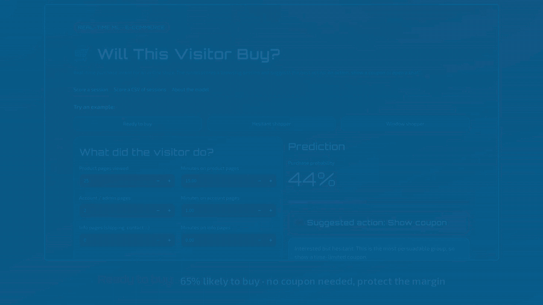

# 🛒 Will This Visitor Buy? Real-Time Purchase Intent

**Most online shoppers leave without buying. This app predicts, from a single browsing session, whether a visitor will purchase, and tells the store what to do right now: no action, show a coupon, or open a chat.**

**▶ Live app:** `PASTE-YOUR-STREAMLIT-LINK-HERE`



## The problem
About 85% of e-commerce sessions end without a purchase. Discounts help, but giving them to everyone wastes margin on people who would have bought anyway. The model ranks every session by purchase intent so the store can act differently for each visitor:

| Purchase probability | Action | Why |
|---|---|---|
| ≥ 60% | ✅ No action | Likely buyer, so a coupon would only cost margin |
| 15% – 60% | 🎟️ Show coupon | Interested but hesitant: the persuadable group |
| < 15% | 💬 Show chat | Low intent: help cheaply, without a discount |

On the held-out test set these bands convert at **80.4%**, **35.8%** and **3.1%** respectively.

## Results
12,330 real sessions, stratified 80/20 split. All models were compared with 5-fold cross-validation on the training set only. The final scores come from the untouched test set (2,466 sessions).

| Model | CV ROC-AUC | CV PR-AUC |
|---|---|---|
| Baseline (always "no purchase") | 0.500 | 0.155 |
| Decision tree | 0.909 | 0.662 |
| KNN | 0.907 | 0.689 |
| Logistic regression | 0.922 | 0.672 |
| Random forest | 0.932 | 0.750 |
| **Gradient boosting (tuned)** | **0.935** | **0.759** |

**Test set, tuned gradient boosting:** ROC-AUC **0.932** · PR-AUC **0.748** (baseline 0.155) · at threshold 0.30 it finds **280 of 382 buyers (recall 0.733)** with precision 0.619.

> Accuracy is not used to pick the model: always predicting "no purchase" already scores 84.5% accuracy while finding zero buyers.

**Key insights from the EDA**
- Visitors who saw a page with *PageValue > 0* convert at **56.3%**, versus **3.9%** for those who did not.
- November converts best (25.4%) and February worst (1.6%). Traffic peaks in May, but conversion does not.
- New visitors convert more often (24.9%) than returning ones (13.9%).
- The main blind spot: 80% of the buyers the model misses had PageValue = 0 (for example, quick direct checkouts).

## What's inside
```
├── app.py                         # Streamlit app (single session + CSV batch scoring)
├── features.py                    # feature engineering shared by notebook and app
├── model/
│   ├── purchase_intent_pipeline.joblib   # full scikit-learn pipeline
│   └── metadata.json                     # threshold, action bands, test metrics
├── notebooks/purchase_intent.ipynb       # framing → EDA → pipeline → models → tuning → evaluation → business insight
├── data/online_shoppers_intention.csv    # UCI dataset (1 MB), see Data below
├── assets/                               # screenshot, demo GIF, sample CSV for the batch tab
└── static/                               # Orbitron and Exo 2 fonts (SIL Open Font License)
```

**Pipeline:** session features (total pages, total time, seconds per product page, has-page-value flag) → `log1p` and scaling for skewed numbers → one-hot encoding with rare categories grouped → `HistGradientBoostingClassifier`. The data is split before anything is fitted, so there is no leakage, and tuning (`RandomizedSearchCV`, 5-fold, PR-AUC) uses the training data only.

## Run it locally
```bash
pip install -r requirements.txt
streamlit run app.py
```
To re-run the analysis: `pip install -r requirements-notebook.txt`, then open `notebooks/purchase_intent.ipynb` and choose *Restart & Run All*.

## Limitations
- One shop and one year of data (no January or April), so it should be retrained before using it on another store.
- The model relies heavily on Google Analytics *page value*.
- The effect of a coupon is not in the data. The campaign simulation in the notebook shows that the business case depends on that effect, so the coupon band should be A/B tested before rollout.

## Data
[Online Shoppers Purchasing Intention Dataset](https://archive.ics.uci.edu/dataset/468), UCI Machine Learning Repository. C. O. Sakar, S. O. Polat, M. Katircioglu and Y. Kastro (2018), *Neural Computing and Applications*. License: CC BY 4.0.

---
Built by **Anas Refaat** · NextGen Institute Machine Learning final project · Python, scikit-learn, Streamlit
